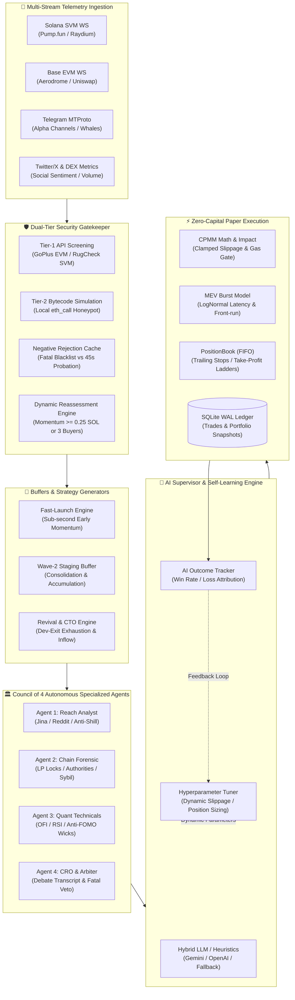

# Bot-MM: Institutional Multi-Chain Autonomous Trading & Alpha Analytics Engine

[](https://www.python.org/downloads/)
[](#-council-of-4-autonomous-agents)
[](#-dual-chain-ingestion--telemetry)
[](#-execution-engine--quantitative-risk)
[](#-state-persistence--observability)
[](#)

A production-grade, event-driven, multi-chain algorithmic trading and alpha analytics engine engineered in Python 3.11+. The engine operates in a zero-capital paper trading simulation environment with local state persistence (SQLite in WAL mode), strictly calibrated to the free-tier quotas of public/developer RPC providers for Solana (Helius) and Base (Alchemy).

---

## 📑 Table of Contents

- [Key System Capabilities](#-key-system-capabilities)
- [System Architecture Overview](#-system-architecture-overview)
- [🏛️ Council of 4 Autonomous Specialized Agents](#️-council-of-4-autonomous-specialized-agents)
- [🧠 AlphaSupervisor-AI & Self-Learning Risk Engine](#-alphasupervisor-ai--self-learning-risk-engine)
- [🛡️ Dual-Tier Security Gatekeeper & Dynamic Reassessment](#️-dual-tier-security-gatekeeper--dynamic-reassessment)
- [📡 Dual-Chain Ingestion & Multi-Source Telemetry](#-dual-chain-ingestion--multi-source-telemetry)
- [🌊 Dual-Phase Staging & Trading Strategies](#-dual-phase-staging--trading-strategies)
- [⚡ Execution Engine & Quantitative Risk Mechanics](#-execution-engine--quantitative-risk-mechanics)
- [💬 Conversational Supervisor & Telegram Interactive Bot](#-conversational-supervisor--telegram-interactive-bot)
- [🏛️ Modular Package Directory Structure](#️-modular-package-directory-structure)
- [🚀 Quickstart & Setup Guide](#-quickstart--setup-guide)
- [⚙️ Configuration & Environment Variables](#️-configuration--environment-variables)
- [💻 CLI Usage & Operational Commands](#-cli-usage--operational-commands)
- [🐳 Docker & Production Deployment](#-docker--production-deployment)
- [🧪 Automated Test Suite](#-automated-test-suite)

---

## 🌟 Key System Capabilities

- **7 Institutional Quantitative Strategies (`alpha_engine.engine.strategy`)**: Momentum Breakout (Volume Profile & OFI), Short-Term Mean Reversion (Z-Score & Bollinger Bands), Liquidity Sweep & Reversal, Whale Accumulation Shadow (Anti-Sybil clustering), Narrative Velocity (Cross-channel virality entropy), Multi-Timeframe Confluence (1m/5m/15m/1h), and Adaptive Regime (Hurst Exponent & Realized Volatility).
- **Comprehensive Self-Learning Engine (`alpha_engine.engine.self_learning`)**: Continuous tracking of mathematical expectancy, Sharpe, Sortino, max drawdown, online Softmax Exponential Gradient policy reinforcement learning, structured loss attribution, and dynamic hyperparameter tuning for Council weights and slippage bounds.
- **Multi-Round Council Debate & Devil's Advocate (`alpha_engine.council`)**: Multi-round structured cross-examination between ReachAnalyst, ChainForensic, and QuantTechnicals, featuring episodic memory retrieval and mandatory Devil's Advocate stress-testing on unanimous approvals.
- **Fully Activated Ruflo Intelligence Swarm (`alpha_engine.ruflo`)**: Adaptive / Mesh / Hierarchical swarm topologies, high-speed lightweight vector store, persistent shared semantic memory, and the 4-stage cognitive intelligence pipeline (Retrieve $\to$ Judge $\to$ Distill $\to$ Consolidate) powered by `RufloLearningAgent`.
- **Real-Time Observability Dashboard (`alpha_engine.dashboard`)**: Institutional dark glassmorphism dashboard powered by FastAPI and WebSockets, streaming decision flow graphs, live strategy leaderboards, agent arena feeds, RPC connection vitals, and self-healing data inconsistency alerts.
- **Conversational Copilot & Interactive Telegram Bot**: Interactive DM bot with 12+ button operational keyboards, inline callbacks, RAG-powered decision explanations (`/why`, `/council`, `/status`), and direct observability access (`/dashboard`, `/strategies`, `/flow`).

---

## 📐 System Architecture Overview



---

## 🏛️ Council of 4 Autonomous Specialized Agents

Located in `alpha_engine/council/`, the Council represents a decentralized hedge-fund deliberation committee. When a candidate token is staged, the agents independently examine distinct dimensions before the Chief Risk Officer (CRO) conducts a structured debate.

```text
                             ┌─────────────────────────────────┐
                             │       CANDIDATE SIGNAL / POOL   │
                             └────────────────┬────────────────┘
                                              │
                      ┌───────────────────────┼───────────────────────┐
                      ▼                       ▼                       ▼
           ┌─────────────────────┐ ┌─────────────────────┐ ┌─────────────────────┐
           │ 1. Reach Analyst    │ │ 2. Chain Forensic   │ │ 3. Quant Technicals │
           │ - Web/Reddit Intel  │ │ - LP Lock & Burn    │ │ - Volume Surge & OFI│
           │ - Jina AI Reader    │ │ - Mint/Freeze Auths │ │ - RSI Exhaustion    │
           │ - Bot-Farm Filter   │ │ - Sybil Cluster Test│ │ - Anti-FOMO Guard   │
           └──────────┬──────────┘ └──────────┬──────────┘ └──────────┬──────────┘
                      │                       │                       │
                      └───────────────────────┼───────────────────────┘
                                              │ Parallel Verdicts
                                              ▼
                             ┌─────────────────────────────────┐
                             │   4. CRO Arbiter (Council Chair)│
                             │   - Structured Debate Transcript│
                             │   - Fatal Veto Gate Enforcement │
                             │   - Differentiated Strategy     │
                             │   - Half-Kelly Position Sizing  │
                             └────────────────┬────────────────┘
                                              │
                                              ▼
                             [ CONSENSUS DECISION: BUY / PASS ]
```

### 1. Agent 1: The Reach Analyst (`ReachAnalystAgent`)
- **Mission**: Evaluates genuine community reach, narrative velocity, and social conviction while filtering out artificial shilling.
- **Zero-API-Key Web Scraper**: Utilizes Jina Reader (`r.jina.ai/<URL>`) to convert project landing pages into clean Markdown without requiring API keys.
- **Public Reddit Intelligence**: Queries public Reddit cryptocurrency JSON search endpoints across multiple subreddits (`r/CryptoMoonShots`, `r/Solana`, `r/Memecoins`).
- **Deception & Bot-Farm Filter**: Scans for inorganic promoter footprints (`dm to promote`, `fast pump`, `airdrop bot`, paid call raids) and flags `PAID_BOT_RAID_DETECTED`.

### 2. Agent 2: Chain Forensic & Microstructure Agent (`ChainForensicAgent`)
- **Mission**: Audits contract bytecode integrity, token authorities, liquidity permanence, and holder distribution.
- **Solana SPL Checks**: Verifies that `mint_authority` and `freeze_authority` are permanently revoked/disabled.
- **EVM Honeypot & Tax Checks**: Confirms that buy/sell transfer taxes do not exceed 3% (300 bps) and that contracts execute clean transfer paths.
- **Liquidity Lock Verification**: Validates that liquidity pool (LP) tokens are burned or locked at $\ge 90\%$ (exempting Pump.fun bonding curves).
- **Sybil & Entropy Audit**: Evaluates Top-10 holder concentration to prevent coordinated developer dumps.

### 3. Agent 3: Quantitative Technical & Revival Agent (`QuantTechnicalsAgent`)
- **Mission**: Assesses market microstructure, order-flow momentum, and technical overextension.
- **Anti-FOMO Guard**: Detects vertical exhaustion wicks. Tokens surging $> 2.5\times$ over dormant market cap without consolidation are flagged with `OVEREXTENDED_GREEN_CANDLE_FOMO`.
- **RSI Exhaustion**: Flags extreme overbought conditions ($RSI_{5m} > 82.0$).
- **Momentum Metrics**: Analyzes Volume Surge Multiplier ($k \ge 1.8\times$), Net Buy Delta ($\ge 0.55$), and Order-Flow Imbalance (OFI).
- **Revival & CTO Detection**: Identifies healthy base consolidation and sustained accumulation following developer capitulation.

### 4. Agent 4: Chief Risk Officer (CRO) & Debate Arbiter (`CouncilArbiterCRO`)
- **Mission**: Moderates the multi-agent debate, enforces absolute veto powers, and computes optimal capital allocation.
- **Fatal Veto Gates**: Instantly blocks execution if:
  1. `ChainForensicAgent` votes `REJECT` (unforgivable contract risk, active freeze authority, honeypot).
  2. `ReachAnalystAgent` flags `PAID_BOT_RAID_DETECTED`.
  3. `QuantTechnicalsAgent` flags `OVEREXTENDED_GREEN_CANDLE_FOMO`.
- **Differentiated Lifecycle Strategies**:
  - **Fast-Launch Early Momentum Strategy** (Token age $\le 30$ min or Pump.fun curve): Weights are 60% Forensic, 30% Quant, 10% Reach. Passing score $\ge 60/100$.
  - **Professional Market Strategy** (Mature / Revival tokens): Weights are 35% Forensic, 45% Quant, 20% Reach. Minimum 2 approvals required; passing score $\ge 65/100$.
- **Fractional Half-Kelly Sizing**: Dynamically computes position allocation using historical closed trades from the ledger:
  - **Uncalibrated State (< 30 closed trades)**: Uses a conservative fixed fraction (default $1.0\%$, configurable via `KELLY_UNCALIBRATED_FRACTION`) to prevent inventing statistical edge.
  - **Calibrated State ($\ge 30$ closed trades)**: Calculates Half-Kelly with Bayesian win-rate shrinkage toward $0.5$ over small samples:
  $$f^* = \frac{p \cdot b - q}{b} \times 0.5$$
  Bounded by configurable portfolio risk caps (e.g. $1.5\%$ - $2.0\%$) and gated by gas friction thresholds.

---

## 🧠 AlphaSupervisor-AI & Self-Learning Risk Engine

Located in `alpha_engine/engine/ai_supervisor.py`, `AlphaSupervisorAI` acts as the institutional risk overseer.

- **Hybrid LLM & Deterministic Fallback**: Leverages Google Gemini (`gemini-3.8-flash` or custom models) or OpenAI with an asynchronous timeout guard ($4.0$s). If RPC, network, or quota issues arise, the engine falls back seamlessly to deterministic institutional rules.
- **Dynamic Global Risk Modes**:
  - `NORMAL`: Standard operation, full Kelly allocation.
  - `DEFENSIVE`: Tightened stop-loss (-8%), halved position sizing.
  - `AGGRESSIVE`: Enhanced sizing for high-conviction momentum runs.
  - `HALT`: Global circuit breaker engaged during systemic volatility.
- **Self-Learning Outcome Tracker (`AIOutcomeTracker`)**:
  - Continuously tracks post-trade price evolution across multiple time horizons ($1$m, $5$m, $15$m, $1$h, $4$h, $24$h).
  - Calculates real-time metrics: Win Rate %, Sharpe Ratio, Sortino Ratio, Maximum Drawdown, and Profit Factor.
  - Performs root-cause **Loss Attribution** (`SLIPPAGE_COLLAPSE`, `LATENCY_FRONT_RUN`, `DECEPTIVE_WASH`, `DEV_DUMP`, `MICRO_TICK_NOISE`).
- **Dynamic Hyperparameter Tuner**: Updates gate thresholds, maximum slippage tolerance, and exit decay constants based on rolling performance.

---

## 🛡️ Dual-Tier Security Gatekeeper & Dynamic Reassessment

Located in `alpha_engine/security/gatekeeper.py`, the Security Gatekeeper guarantees that capital is never committed to unverified or hazardous assets.

### Multi-Tier Verification Pipeline
1. **Tier-1 External API Screening**:
   - **Base EVM**: Real-time GoPlus Security API audit (taxes, honeypot flags, proxy implementations, blacklisting functions).
   - **Solana SVM**: RugCheck API audit (mint/freeze authorities, top holder concentration, LP lock status).
2. **Tier-2 Bytecode Preflight Simulation**:
   - Executes local `eth_call` transaction simulation against Aerodrome/Uniswap routers to verify that buy and sell flows execute without bytecode revert errors.

### Smart Probation & Dynamic Reassessment Engine
Standard blacklists permanently drop tokens, blinding bots to legitimate Community Takeovers (CTOs) and delayed liquidity locks. The engine solves this via a dual-tier cache:

| Rejection Category | Trigger Conditions | Cache Action | Reassessment Eligibility |
| :--- | :--- | :--- | :--- |
| **Fatal Scam** | Confirmed honeypot, drainer bytecode, sell tax $\ge 90\%$, blacklisted deployer. | Permanent Blacklist (Full TTL) | **Never** — Zero tolerance. |
| **Soft Suspicious** | Unlocked LP at block 0, low initial holders, active mint authority during migration. | Probation Window ($45\text{s} - 1200\text{s}$) | **Dynamic Reassessment** if probation elapses, volume $\ge 0.25$ SOL/ETH, or $\ge 3$ distinct buyers arrive. |

When dynamic reassessment triggers, the token is cleanly re-screened. If the developer dumped, burnt LP, and the community assumed control, the engine seamlessly captures the revival trade.

---

## 📡 Dual-Chain Ingestion & Multi-Source Telemetry

Located in `alpha_engine/ingestion/`, the engine consumes high-frequency on-chain and off-chain data streams:

```text
 ┌────────────────────────────────────────────────────────────────────────┐
 │                      INGESTION COORDINATOR                            │
 └──────┬───────────────────┬───────────────────┬───────────────────┬─────┘
        │                   │                   │                   │
        ▼                   ▼                   ▼                   ▼
┌───────────────┐   ┌───────────────┐   ┌───────────────┐   ┌───────────────┐
│ Solana SVM WS │   │ Base EVM WS   │   │ Telegram Ingest│   │ Twitter / DEX │
│ (Helius RPC)  │   │ (Alchemy RPC) │   │ (Telethon MT) │   │ (DexScreener) │
├───────────────┤   ├───────────────┤   ├───────────────┤   ├───────────────┤
│• Pump.fun Mint│   │• Uniswap v2/v3│   │• Alpha Channels│  │• X Sentiment  │
│• Pump.fun Swap│   │• Aerodrome    │   │• Regex CA Pull│   │• 1m/5m Volume │
│• Raydium AMM  │   │• Sync/Swap Log│   │• Anti-Sybil   │   │• Spikes / OFI │
│• Auto-reconnect│  │• Topics decode│   │• Session Auth │   │• GeckoTerminal│
└───────────────┘   └───────────────┘   └───────────────┘   └───────────────┘
```

- **Solana SVM Ingester (`svm.py`)**: Subscribes to Helius WebSocket logs. Implements specialized binary decoders for Pump.fun bonding curve mints, bonding curve swaps, and Raydium pool initializations.
- **Base EVM Ingester (`evm.py`)**: Subscribes to Alchemy WebSocket log filters for Aerodrome and Uniswap factory and pair contracts. Decodes raw `Swap(...)` and `Sync(...)` topics into standardized `SwapEvent` schemas.
- **Telegram Channel Ingester (`telegram.py`)**: Native Telethon MTProto client with session file persistence. Monitors curated alpha channels, parses EVM (`0x...`) and Solana (Base58) contract addresses via regex, detects coordinated pump-and-dump spikes, and hosts an interactive DM bot.
- **DEX Metrics Aggregator (`dex_metrics.py`)**: Maintains in-memory sliding-window deques ($1$m, $5$m, $1$h) calculating rolling volume, net buying volume, and volumetric spike ratios without saturating external rate limits.

---

## 🌊 Dual-Phase Staging & Trading Strategies

Located in `alpha_engine/engine/staging.py` and `alpha_engine/engine/strategy/`:

### 1. Fast-Snipe Early Momentum Strategy
- **Target**: Fresh liquidity pairs and early Pump.fun bonding curves ($< 30$ minutes old).
- **Execution**: Sub-second execution following security gate passage.
- **Exit Regime**:
  - Velocity Decay Timeout: Closes position if $PnL < +3\%$ after $120$ seconds.
  - Hard Stop-Loss: $-8\%$ to $-12\%$.
  - Scaled Take-Profit: $50\%$ scale-out at $+25\%$, remaining $50\%$ at $+50\%$.

### 2. Wave-2 Staging Buffer (`Wave2StagingBuffer`)
- **Target**: Post-launch consolidation dips following the initial speculative wave.
- **Mechanics**: Stages tokens into 60-second volume buckets. Evaluates price stabilization, holder accumulation velocity, and order-flow reversal before authorizing a breakout buy.

### 3. Revival & CTO Breakout Strategy (`RevivalBreakoutBuffer`)
- **Target**: Established meme tokens that experienced a developer exit, deep price drawdown, and subsequent organic community resurgence.
- **Criteria**:
  - Dev-Exit Confirmation: Developer balance reaches zero or $> 95\%$ liquidated.
  - Consolidation Floor: Price stabilizes for hours/days with diminishing sell volume.
  - Volume Surge Multiplier: Trading volume surges $\ge 2.5\times$ over dormant baseline.
- **Exit Profile (`REVIVAL_SWING`)**:
  - Extended holding horizon (multi-hour to multi-day).
  - Trailing Stop: $35\%$ drawdown from All-Time High (ATH) peak.
  - Stepped Take-Profit Ladder: $50\%$ at $2\times$ ($+100\%$), $25\%$ at $3\times$, $25\%$ at $5\times$, maintaining a moonbag for $10\times$.

---

## ⚡ Execution Engine & Quantitative Risk Mechanics

Located in `alpha_engine/math/` and `alpha_engine/execution/`:

### Constant Product AMM (CPMM) Math
Deterministic pricing mechanics for standard constant-product pools ($x \cdot y = k$):
- **Unified Price**: Native token per base token ($\text{NATIVE\_PER\_TOKEN}$).
- **Clamped Price Impact**:
  $$\text{Impact (bps)} = \min\left(10000, \; \frac{\Delta x}{x + \Delta x} \times 10000\right)$$
- **Gas-Drag Gate**: Rejects any trade where estimated transaction fees exceed $2.5\%$ of expected alpha yield.

### Stochastic MEV & Latency Simulation
To ensure realistic paper trading without historical over-fitting, the engine models real-world execution friction, price movement during latency, and route-conditional MEV:
- **Per-Chain Latency Distribution**:
  - **Solana**: $45\text{ms} - 320\text{ms}$ Log-Normal latency sampling (Source: [Solana Labs Consensus Docs](https://docs.solanalabs.com/consensus/fork-generation#slot-time) reflecting 400ms target slot time, sub-slot TPU/QUIC broadcast, and Jito bundle landing).
  - **Base**: $150\text{ms} - 2000\text{ms}$ Log-Normal latency sampling (Source: [Base Docs](https://docs.base.org/chain/block-time/) reflecting 2.0s OP Stack block production time and sequencer receipt).
- **Latency-Aware Fill Determination**: Fills are priced from the freshest pool state observed AT `signal_time + latency`. In paper mode, orders are held pending until the target fill time is reached (bounded by `fill_timeout_ms`). If the market moves up or down during the latency window, the fill price reflects that movement. If no pool state fresher than `fill_max_stale_ms` (default 4.0s) exists at fill time, the fill is rejected fail-closed with telemetry counter `stale_pool_at_fill_rejected`.
- **Route-Conditional MEV & Sandwich Attack Model**:
  - **Private Relays & Bundles (`is_private_route=True`)**: Transactions routed through private endpoints (Flashbots/Titan on EVM, Jito bundles on SVM) have ZERO public mempool exposure, resulting in 0 frontrun volume and 0 adverse price drag.
  - **Public Mempool Exploitation**: In unprotected routes, frontrunning applies only when the trade has sufficient pool depth impact (`depth >= 0.5%`) and wide slippage tolerance (`slippage >= 50 bps`). Searcher extraction scales with trade size and depth, consuming allowable slippage up to `mev_max_sandwich_impact_bps` (500 bps ceiling).
  - **Deterministic Seeding**: All stochastic latency and MEV draws are seeded via `execution_seed` (default: 42) for reproducible simulation.
- **Unified Engine Simulation Parity**: Live Paper (`PaperExecutor`), Shadow Tournament (`StrategyTournamentRegistry`), and Walk-Forward Optimization (`WalkForwardBacktester`) share the exact same `alpha_engine.math.mev` module and pending-fill execution assumptions.

### 🏛️ Venue Support & Execution Capabilities Table

The execution simulator enforces explicit fail-closed routing based on the verified venue capability matrix (`alpha_engine.pricing.venue_capabilities`):

| Chain | Execution Venue | Status | Default LP Fee | CPMM Modeling & Execution Mechanics |
| :--- | :--- | :---: | :---: | :--- |
| **Solana (SVM)** | **Pump.fun** | **Supported** | 100 bps (1.00%) | Virtual token/SOL constant product curve, graduation to Raydium |
| **Solana (SVM)** | **Raydium AMM (v4)** | **Supported** | 25 bps (0.25%) | Constant product $x \cdot y = k$ pool math with latency & MEV |
| **Solana (SVM)** | **Raydium CPMM** | **Supported** | 25 bps (0.25%) | Standard constant-product fee tier with pool reserve tracking |
| **Solana (SVM)** | **Raydium CLMM** | **Unsupported** | 25 bps | **Fail-Closed**: Concentrated liquidity tick arrays rejected |
| **Solana (SVM)** | **Orca Whirlpool** | **Unsupported** | 30 bps | **Fail-Closed**: Concentrated liquidity tick arrays rejected |
| **Base (EVM)** | **Uniswap v2** | **Supported** | 30 bps (0.30%) | Standard UniswapV2Pair reserves with local RPC simulation |
| **Base (EVM)** | **Uniswap v3** | **Supported** | 30 bps (0.30%) | Standard fee tier with CPMM single-tick equivalent modeling |
| **Base (EVM)** | **Aerodrome** | **Supported** | 30 bps (0.30%) | Volatile pool $x \cdot y = k$ reserves on Base L2 |

Any order signal targeting an unsupported venue (e.g. Raydium CLMM or Orca Whirlpool) is rejected immediately with zero balance impact.

### Position Book & State Persistence
- **PositionBook (`book.py`)**: In-memory portfolio tracking with First-In-First-Out (FIFO) tax lots, tracking realized PnL, unrealized PnL, and maximum run-up.
- **SQLiteLedger (`ledger.py`)**: Thread-safe asynchronous SQLite database running in **WAL (Write-Ahead Logging)** mode with `synchronous = NORMAL` and 30-second busy timeout locks. Persists all fills, decisions, and periodic portfolio snapshots.

### Strategy Tournament & Promotion Governance
The strategy tournament (`StrategyTournamentRegistry` in `experimentation.py`) executes parallel shadow lots for challenger variants alongside the live Champion:
- **Sample Size Gate**: Minimum 50 closed shadow trades (`tournament_min_promotion_trades`, or 30 if champion is underperforming) to ensure statistical significance.
- **Statistical Confidence Criterion**: 95% bootstrap lower bound of expectancy must be strictly positive ($> \$0.00$ at `tournament_bootstrap_confidence_level=0.95`, 1,000 resamples).
- **Out-of-Sample (OOS) Consistency**: Time-split validation gate (70% in-sample, 30% out-of-sample). The challenger must maintain positive Net PnL, Profit Factor $\ge 1.20$, bounded drawdown, and positive Sortino on the unseen later segment.
- **Risk-Adjusted Hurdle**: Sortino ratio must exceed Champion by $\ge 0.10$ with Profit Factor $\ge 1.35$ and Maximum Drawdown $< 8.0\%$ (or $< 12.0\%$ if champion is bleeding).
- **Outlier Win Gate**: $\le 60\%$ of total profits may derive from a single windfall trade.
- **Cooldown & Rollback Safety**: Minimum 10 trades / 300s cooldown between promotions. If a newly promoted champion loses $\ge \$20.00$ or drops below 25% win rate in its first 10 live trades, it is automatically demoted back to shadow and the previous champion is restored.
- **Atomic Live Synchronization**: Promotion atomically updates runner exit parameters (`hard_stop_loss_pct`, `custom_take_profit_pct`, `trailing_stop_from_peak_pct`, `time_exit_s`, `min_entry_score`) and refreshes open lot exit rules in `PositionBook`.


---

## 💬 Conversational Supervisor & Telegram Interactive Bot

Located in `alpha_engine/chat_interface.py` and `alpha_engine/ingestion/telegram.py`, the engine features an interactive AI copilot:

### Interactive Telegram Reply Keyboard
Authorized operators receive an interactive 14-button reply keyboard:

| Row | Buttons | Description |
| :---: | :--- | :--- |
| **1** | `📊 Status` \| `🧠 AI Supervisor` \| `📋 Trades` | Core engine status, AI risk posture, recent fills |
| **2** | `🔍 Assets` \| `🌊 Staging` \| `🔄 Revival` | Active holdings, Wave-2 buffer, Revival buffer |
| **3** | `🛡️ AI Vetoes` \| `📈 Performance` \| `📡 Signals` | Blocked trades, win rate & Sharpe ratio, active signals |
| **4** | `📰 News` \| `🐋 Whales` \| `🩺 Doctor` | Scraped news, whale wallet alerts, system health |
| **5** | `❓ Help` \| `🌐 Research` | Command guide and deep narrative research |

### Available Bot & CLI Commands

```text
/status                 - Display real-time engine health, balances, and open positions
/perf [hours]           - Display trading performance, win rate, and profit factor
/assets                 - List all current open positions with interactive exit buttons
/exit <CA>              - Immediately execute a simulated market sell on a held token
/council <CA>           - Trigger on-demand 4-Agent Council debate & transcript for a token
/why <CA>               - RAG natural language explanation of why a token was bought or passed
/staging                - Inspect tokens currently monitored in the Wave-2 Staging Buffer
/revival                - Inspect dormant tokens monitored in the Revival / CTO Buffer
/reset_governor         - Reset trade pacing and frequency governors after rate-limit cool-down
/doctor                 - Run comprehensive diagnostics on RPCs, databases, and dependencies
```

---

## 🏛️ Modular Package Directory Structure

```text
Bot-MM/
├── pyproject.toml                         # Package build metadata & dependencies
├── requirements.txt                       # Categorized production dependencies
├── requirements-dev.txt                   # Development & testing dependencies
├── Dockerfile                             # Multi-stage hardened production Dockerfile (Python 3.12)
├── docker-compose.yml                     # 24/7 autonomous daemon & CLI deployment spec
├── .dockerignore                          # Build context sanitization & zero-leak security
├── README.md                              # System architecture documentation
├── .env.example                           # Template environment configuration
│
├── alpha_engine/                          # Core modular package
│   ├── __init__.py                        # Unified public API exports
│   ├── __main__.py                        # Module launcher: python -m alpha_engine
│   ├── cli.py                             # Command-line interface parser
│   ├── config.py                          # Environment settings & Pydantic validation
│   ├── chat_interface.py                  # Conversational AI copilot & RAG explainer
│   ├── logging_config.py                  # Structured JSON logging & console formatting
│   ├── tracer.py                          # Distributed lifecycle tracing & observability
│   ├── dns_resolver.py                    # DNS-over-HTTPS fallback resolver
│   │
│   ├── council/                           # Council of 4 Autonomous Specialized Agents
│   │   ├── __init__.py                    # Council exports
│   │   ├── models.py                      # AgentVote, AgentVerdict, CouncilConsensusResult
│   │   ├── reach_agent.py                 # Agent 1: The Reach Analyst (Web / Reddit / Anti-Shill)
│   │   ├── forensic_agent.py              # Agent 2: On-Chain Forensic & Microstructure Agent
│   │   ├── quant_agent.py                 # Agent 3: Quantitative Technical & Revival Agent
│   │   └── arbiter_cro.py                 # Agent 4: Chief Risk Officer (CRO) & Debate Arbiter
│   │
│   ├── engine/                            # Orchestration, Staging & Strategy
│   │   ├── __init__.py                    # Engine exports
│   │   ├── runner.py                      # PaperTradingEngine asynchronous coordinator
│   │   ├── ai_supervisor.py               # Institutional AI Supervisor & Outcome Tracker
│   │   ├── staging.py                     # Wave-2 Staging Buffer & Revival Breakout Buffer
│   │   ├── signals.py                     # Multi-factor signal generation engine
│   │   ├── registry.py                    # Dynamic in-memory liquidity pool registry
│   │   ├── rpc_health.py                  # RPC health monitor & circuit breaker
│   │   └── strategy/                      # Strategy modules
│   │       ├── __init__.py                # Strategy exports
│   │       ├── scoring.py                 # Composite Strategy V2 multi-metric scoring
│   │       ├── risk_manager.py            # Portfolio drawdown & trade pacing governor
│   │       ├── market_quality.py          # Spread, liquidity depth & toxicity filters
│   │       └── exit_engine.py             # Staged TP ladders & trailing stop engine
│   │
│   ├── security/                          # Dual-Tier Security Gatekeeper
│   │   ├── __init__.py                    # Security exports
│   │   ├── gatekeeper.py                  # Gatekeeper orchestrator & probation manager
│   │   ├── goplus.py                      # Base EVM GoPlus API client
│   │   ├── rugcheck.py                    # Solana SVM RugCheck API client
│   │   ├── preflight.py                   # Local eth_call honeypot simulation
│   │   └── constants.py                   # Thresholds, ABIs & router addresses
│   │
│   ├── ingestion/                         # Real-Time Telemetry Ingestion
│   │   ├── __init__.py                    # Ingestion exports
│   │   ├── coordinator.py                 # Multiplexed IngestionCoordinator
│   │   ├── svm.py                         # Solana WebSocket (Pump.fun / Raydium decoders)
│   │   ├── evm.py                         # Base EVM WebSocket (Aerodrome / Uniswap decoders)
│   │   ├── telegram.py                    # Telegram MTProto client, scraper & DM bot
│   │   ├── x_stream.py                    # Twitter/X API v2 social sentiment stream
│   │   ├── dex_metrics.py                 # Real-time sliding-window DEX metrics
│   │   └── decoders.py                    # ABI topic decoders & transaction unpackers
│   │
│   ├── execution/                         # Paper Execution & Persistence
│   │   ├── __init__.py                    # Execution exports
│   │   ├── executor.py                    # Simulated execution with slippage & latency
│   │   ├── book.py                        # PositionBook (FIFO tax lots & metrics)
│   │   ├── ledger.py                      # SQLiteLedger (WAL mode, trades & snapshots)
│   │   └── bundle.py                      # Private MEV / Jito bundle simulation
│   │
│   ├── math/                              # Quantitative Math & Sizing
│   │   ├── __init__.py                    # Math exports
│   │   ├── cpmm.py                        # Constant-product AMM pricing & impact
│   │   ├── sizing.py                      # Half-Kelly sizing & gas-drag gates
│   │   └── mev.py                         # Stochastic LogNormal MEV burst model
│   │
│   ├── rate_limiter/                      # RPC Quota Protection
│   │   ├── __init__.py                    # Rate limiter exports
│   │   ├── bucket.py                      # AsyncTokenBucket with continuous leak
│   │   └── registry.py                    # Quota registry (Alchemy 20 CU/s, Helius 8 req/s)
│   │
│   ├── profiler/                          # Smart Money & Wallet Profiler
│   │   ├── __init__.py                    # Profiler exports
│   │   ├── profiler.py                    # Behavioral profiler & cluster analysis
│   │   ├── evaluator.py                   # Win-rate, PnL & holding time evaluator
│   │   └── whitelist_db.py                # Local SQLite wallet reputation database
│   │
│   ├── reach/                             # Social Intelligence & Doctor
│   │   ├── __init__.py                    # Reach exports
│   │   ├── engine.py                      # Jina Reader & multi-source web intelligence
│   │   └── doctor.py                      # Comprehensive System Doctor diagnostic suite
│   │
│   └── models/                            # Strict Pydantic v2 Domain Models
│       ├── __init__.py                    # Model exports
│       ├── enums.py                       # Chains, OrderSides, Venues, Tiers, ExitProfiles
│       ├── events.py                      # SwapEvent, SignalEvent, PumpSwapEvent
│       ├── state.py                       # PoolState, SecurityReport, TradeRecord
│       ├── ai.py                          # AISupervisorResponse, OutcomeMetrics
│       ├── decisions.py                   # Structured DecisionRecord schema
│       └── news.py                        # NewsEvent, WhaleAlert schemas
│
├── tests/                                 # Automated Test Suite (26 Modules)
│   ├── test_modular_architecture.py       # Core package architecture & imports
│   ├── test_autonomous_engine.py          # End-to-end engine integration
│   ├── test_ai_supervisor.py              # AI supervisor & heuristics validation
│   ├── test_telegram_commands_and_buttons.py # Bot keyboards & command routing
│   ├── test_svm_websocket_and_pump_fun_decoding.py # Solana decoding
│   └── ...                                # 21 additional specialized test modules
│
└── Backward-Compatibility Facades (Root Level):
    ├── engine.py, execution.py, ingestion.py, models.py, quant_math.py, rate_limiter.py, security.py
```

---

## 🚀 Quickstart & Setup Guide

### 1. Prerequisites
- **Python**: Version `3.11` or higher.
- **Operating System**: Linux (Ubuntu 22.04+ recommended), macOS, or Windows (WSL2).
- **SQLite**: Version `3.35+` (supports WAL mode).

### 2. Clone & Virtual Environment Setup
```bash
git clone https://github.com/jamalabbay97/Bot-MM.git
cd Bot-MM

# Create and activate virtual environment
python3 -m venv .venv
source .venv/bin/activate

# Upgrade pip and install package in editable mode
pip install --upgrade pip
pip install -e .
```

### 3. Configure Credentials
Copy the example environment configuration and supply your API keys:
```bash
cp .env.example .env
nano .env
```

---

## ⚙️ Configuration & Environment Variables

Key parameters in `.env`:

```bash
# ------------------------------------------------------------------------------
# 1. RPC Endpoints (100% Free Developer Tier Quotas)
# ------------------------------------------------------------------------------
BASE_RPC_HTTP=https://base-mainnet.g.alchemy.com/v2/YOUR_ALCHEMY_KEY
BASE_RPC_WS=wss://base-mainnet.g.alchemy.com/v2/YOUR_ALCHEMY_KEY
SOLANA_RPC_HTTP=https://mainnet.helius-rpc.com/?api-key=YOUR_HELIUS_KEY
SOLANA_RPC_WS=wss://mainnet.helius-rpc.com/?api-key=YOUR_HELIUS_KEY

# ------------------------------------------------------------------------------
# 2. AI Supervisor & LLM Settings
# ------------------------------------------------------------------------------
AI_SUPERVISOR_ENABLED=true
AI_PROVIDER=gemini                         # 'gemini' or 'openai'
GEMINI_API_KEY=YOUR_GEMINI_API_KEY         # Optional: Leave empty for local deterministic heuristics
AI_MODEL=gemini-3.8-flash
AI_TIMEOUT_S=4.0
AI_STRICT_VETO=true

# ------------------------------------------------------------------------------
# 3. Telegram Ingestion & Interactive DM Bot (Optional)
# ------------------------------------------------------------------------------
TELEGRAM_API_ID=YOUR_TELEGRAM_API_ID       # From https://my.telegram.org
TELEGRAM_API_HASH=YOUR_TELEGRAM_API_HASH
TELEGRAM_BOT_TOKEN=YOUR_BOT_TOKEN          # From @BotFather (for headless bot mode)
TELEGRAM_CHANNELS="insiderpaper,disclosetv,TreeNewsFeed,lookonchain"
TELEGRAM_ADMIN_IDS=123456789,987654321     # Your numeric Telegram user ID(s)

# ------------------------------------------------------------------------------
# 4. Simulated Balances & Risk Controls
# ------------------------------------------------------------------------------
INITIAL_SOL_BALANCE=10.0                   # Starting paper balance: 10 SOL
INITIAL_ETH_BALANCE=2.0                    # Starting paper balance: 2 ETH
MAX_PORTFOLIO_RISK_PCT=0.01                # 1% standard trade risk
MAX_AUTONOMOUS_RISK_PCT=0.05               # 5% max risk cap for high-conviction trades
STOP_LOSS_PCT=-0.15                        # Initial hard stop-loss trigger (-15%)

# ------------------------------------------------------------------------------
# 5. Live Native Price Service & Multi-Source Gating
# ------------------------------------------------------------------------------
# Single source of truth for native asset prices (SOL & ETH) in USD.
# Primary source: DefiLlama. Secondary source: Coinbase / Binance.
ALLOW_STATIC_NATIVE_PRICES=false           # Set true only for static bootstrap/test overrides
SOL_PRICE_USD=150.0                        # Static override (only used when ALLOW_STATIC_NATIVE_PRICES=true)
ETH_PRICE_USD=3400.0                       # Static override (only used when ALLOW_STATIC_NATIVE_PRICES=true)
NATIVE_PRICE_REFRESH_INTERVAL_S=30.0       # Background refresh cadence in seconds
NATIVE_PRICE_CACHE_TTL_S=15.0              # TTL cache validity in seconds
NATIVE_PRICE_MAX_AGE_S=60.0                # Max price age before transitioning to STALE
NATIVE_PRICE_DIVERGENCE_TOLERANCE_PCT=5.0  # Max divergence % between primary and secondary
```

---

## 💻 CLI Usage & Operational Commands

The engine provides an institutional command-line launcher via `alpha-engine`:

```bash
# Display CLI help and options
alpha-engine --help

# Run the engine in demonstration mode with mock liquidity pools
alpha-engine --demo

# Run system doctor diagnostics (verifies RPCs, database, dependencies, network)
alpha-engine --doctor

# Query real-time portfolio status and equity curves
alpha-engine --status

# Display recent paper trade execution history from SQLite
alpha-engine --trades

# Display recent token screening signals
alpha-engine --signals

# Display recent news ingestion and sentiment logs
alpha-engine --news

# Display on-chain whale activity logs
alpha-engine --whales

# Display AI Supervisor status, risk posture, and rolling metrics
alpha-engine --ai

# Inspect structured DecisionRecord audit logs
alpha-engine --decisions

# Run on-demand AI forensics audit on a specific token contract
alpha-engine --audit <TOKEN_ADDRESS>

# Launch the interactive Conversational AI copilot in your terminal
alpha-engine --chat

# Reset trade frequency and pacing governors
alpha-engine --reset-governor
```

---

## 🐳 Docker & Production Deployment

The repository includes a production-hardened multi-stage `Dockerfile` and a `docker-compose.yml` daemon configuration.

### Deploy 24/7 with Docker Compose:
```bash
# 1. Build and start the autonomous engine daemon in background
docker compose up -d --build

# 2. View real-time streaming engine logs
docker compose logs -f bot-mm

# 3. Check container resource utilization & health status
docker compose ps
docker stats bot-mm-engine

# 4. Run interactive operator CLI commands without interrupting the daemon
docker compose run --rm cli --status
docker compose run --rm cli --doctor
docker compose run --rm cli --trades

# 5. Graceful stop (allows 30-second WAL checkpointing & task drain)
docker compose down
```

### Production Container Features:
- **Fast Layer Caching**: Builds dependencies from `requirements.txt` independently of source code changes.
- **Process Supervisor (Tini)**: Proper PID 1 init system preventing zombie processes and guaranteeing signal forwarding (`SIGTERM`/`SIGINT`).
- **Non-Root Execution**: Runs under unprivileged UID/GID `10001:10001` with nologin shell.
- **Kernel Sandboxing**: Drops all capabilities (`cap_drop: ALL`) and enforces `no-new-privileges:true`.
- **Healthcheck & Telemetry**: Periodic 30s engine import healthchecks with container health monitoring.
- **Resource Constraints**: Capped at `1.5` CPUs and `1024 MB` RAM to prevent host starvation.
- **Log Rotation**: Built-in JSON log rotation (`20MB` max per file, 5 backups).
- **Persistent Storage**: Maps `./data` and `./logs` volumes for uninterrupted WAL checkpointing.
- **Zero-Leak Build Context**: Rigorous `.dockerignore` filters secrets, database WALs, and session tokens.

---

## 🧪 Automated Test Suite

Bot-MM includes a comprehensive test suite of **26 test modules** covering mathematical correctness, WebSocket decoders, AI supervisor heuristics, and database integrity.

```bash
# Run the core modular architecture validation suite
python3 tests/test_modular_architecture.py

# Run individual test modules
python3 -m unittest tests/test_modular_architecture.py
python3 -m unittest tests/test_telegram_commands_and_buttons.py
```

### Verified Test Cases:
1. `test_modular_package_imports`: Verifies clean imports across all submodules.
2. `test_backward_compatibility_facades`: Confirms root-level facade stability.
3. `test_cpmm_math_and_unified_price`: Validates constant-product pricing and slippage clamping.
4. `test_mev_lognormal_burst_and_latency`: Validates stochastic latency distributions.
5. `test_position_sizing_and_gas_gate`: Validates fractional Kelly formulas and gas friction gates.
6. `test_evm_decoders_and_normalization`: Validates ABI event unpacking.
7. `test_position_book_fifo`: Tests FIFO accounting and running PnL calculations.
8. `test_sqlite_ledger_persistence`: Validates SQLite WAL mode transactions and concurrency.

---

## ⚠️ Known Limitations & Unverified Items

In adherence to the Anti-Shallow Contract and truthful engineering standards, the following aspects are explicitly documented as **UNVERIFIED** or subject to operational constraints:

1. **Simulation-Only Execution (No Live Orders)**: Real on-chain order placement and transaction submission (RPC `sendTransaction`) are intentionally NOT implemented in this engine. The engine operates purely as a paper trading, backtesting, and market analytics system. Live private key execution must not be enabled without separate custodial infrastructure.
2. **Private Route Assumption**: When `is_private_route=True` is configured, MEV frontrun drag is modeled as 0 bps under the assumption that Jito bundles (Solana) or Flashbots/Titan builders (Base) protect against public mempool visibility. Under severe RPC network congestion or bundle landing misses, real transactions would experience public fallback or drop.
3. **Concentrated Liquidity (CLMM) Approximations**: Pools utilizing concentrated liquidity (Raydium CLMM, Uniswap v3 full tick arrays) are either rejected fail-closed or evaluated under single-tick CPMM assumptions. Fills crossing tick boundaries are not modeled.
4. **Off-Chain Price Service Fallback**: During multi-source price aggregation, if external API quotes (DexScreener, GeckoTerminal, DeFiLlama) become unavailable, the engine fails closed unless static price fallbacks are explicitly enabled for testing.
5. **LLM Advisory Fallback**: If LLM provider APIs (Gemini, Claude, DeepSeek) experience rate limits or downtime, the Council automatically falls back to deterministic rule-based heuristics (`deterministic_fallback=True`), explicitly tagged in telemetry and decision ticks.
6. **Multi-Hop Route Optimization**: Cross-pool aggregators (Jupiter on Solana, 1inch on Base) are represented via spot quotes and single-pool equivalents rather than multi-leg atomic bundle execution.

---

## ⚠️ Disclaimer

This software is engineered strictly for **educational, quantitative research, and paper-trading simulation purposes**. It does not constitute financial, investment, or legal advice. Cryptocurrency trading involves substantial financial risk. The engine operates by default in a zero-capital simulation environment.
